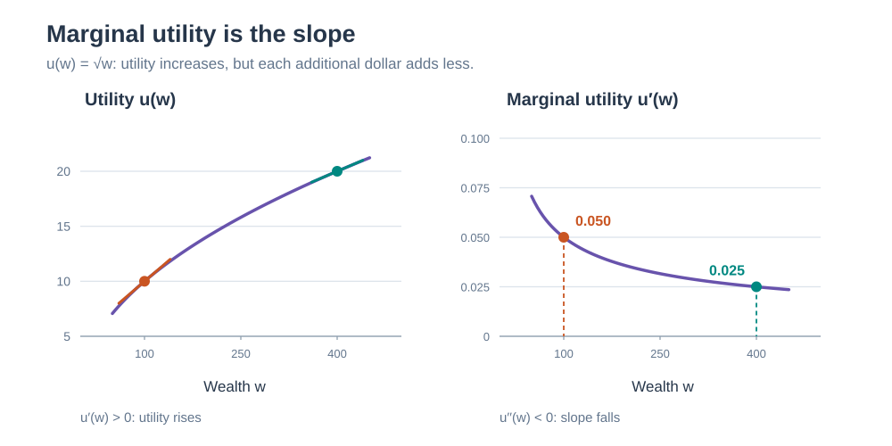
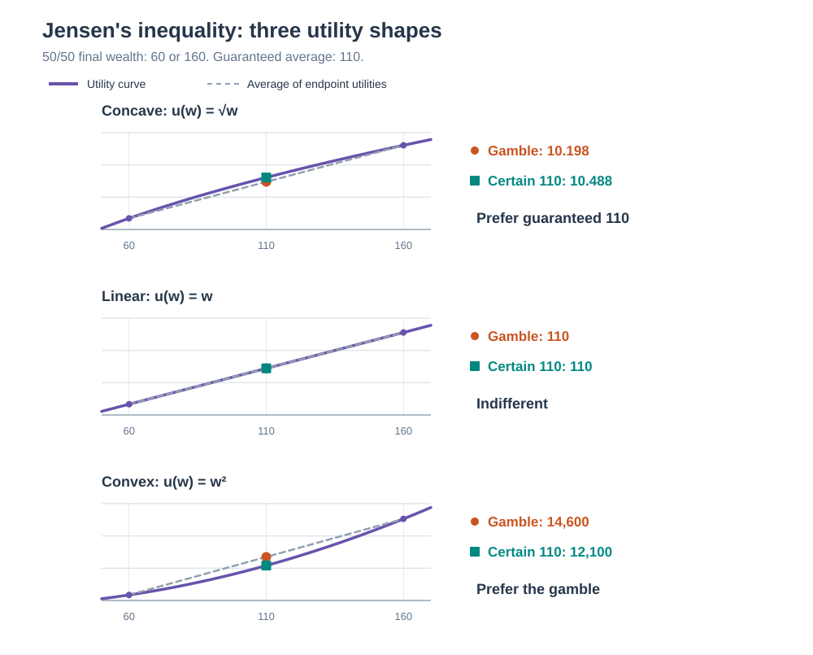
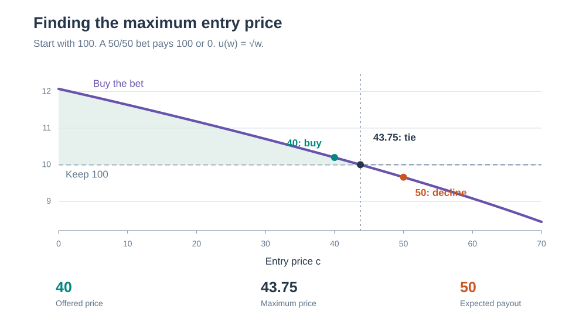
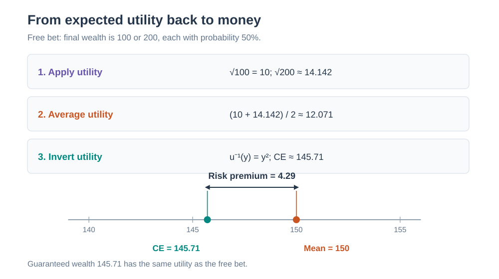

# Utility and risk aversion

Utility $u(w)$ assigns a number to wealth $w$ so that choices under uncertainty can be compared. Assume zero interest, a fixed payment date, and actual probabilities $P$. All money amounts use the same currency.

## 1. The utility function describes preferences

The first derivative is the **marginal utility of wealth**: the rate at which utility increases with wealth.

$$
\operatorname{MU}(w)=u'(w)=\frac{du}{dw}, \qquad \Delta u\approx u'(w)\,\Delta w \quad\text{for a small change }\Delta w.
$$

The second derivative $u''(w)$ measures how marginal utility changes as wealth increases.

| Condition | Term | Meaning |
|---|---|---|
| $u'(w)>0$ | Positive marginal utility | More wealth is preferred. |
| $u''(w)<0$ | Diminishing marginal utility; concave utility | Each additional dollar adds less utility: risk aversion. |
| $u''(w)=0$ | Constant marginal utility; linear utility | Each additional dollar adds the same utility: risk neutrality. |
| $u''(w)>0$ | Increasing marginal utility; convex utility | Each additional dollar adds more utility: risk seeking. |

The risk classifications assume increasing utility. For $u(w)=\sqrt w$ and $w>0$:

$$
u'(w)=\frac{1}{2\sqrt w}>0, \qquad u''(w)=-\frac{1}{4w^{3/2}}<0.
$$

Marginal utility is **0.05** utility units per dollar at wealth 100 and **0.025** at wealth 400. This is diminishing marginal utility.

Utility scales have these freedoms and limits:

- Negative utility is valid; zero has no special meaning. For example, $u(w)=-e^{-w}$ is negative everywhere, increasing, and concave.
- A positive affine transformation $v(w)=au(w)+b$, with $a>0$, preserves all expected-utility choices. Relative order alone is insufficient for bets: nonlinear transformations can change how outcome utilities average.
- Interpersonal utility comparisons require additional assumptions about a common scale. One person's score of 20 cannot be interpreted as greater well-being than another person's score of 10. Raw marginal utilities also have arbitrary scales, since $v'(w)=au'(w)$.

## 2. Expected utility averages the utility of each possible final wealth

| Symbol | Meaning |
|---|---|
| $W$ | Starting wealth, assumed certain |
| $X_i$ | Bet's payout in outcome $i$; negative means a payment you owe |
| $p_i$ | Actual probability of outcome $i$ |
| $c$ | Entry price paid before the outcome is known |
| $W+X_i-c$ | Final wealth in outcome $i$ |

$$
E_P[u(W+X-c)]=\sum_i p_i u(W+X_i-c).
$$

Apply $u$ to each outcome, then average. For a 50/50 bet paying 100 or 0, starting from $W=100$ and paying $c=40$:

$$
E_P[u(W+X-c)] =\tfrac12\sqrt{160}+\tfrac12\sqrt{60} \approx 10.198.
$$

Keeping the money gives $u(100)=10$, so this buyer prefers entering at 40. In general, concavity gives **Jensen's inequality**:

$$
\underbrace{E_P[u(Z)]}_{\text{expected utility of uncertain wealth}} \ \le\ \underbrace{u(E_P[Z])}_{\text{utility of its certain average}}.
$$

Here $Z$ is any admissible final wealth. The inequality is strict for strictly concave utility and nonconstant $Z$. Linear utility gives equality; convex utility reverses the inequality.

The dashed line joins the utilities of the two outcomes. Its midpoint gives $E_P[u(Z)]$; the curve at mean wealth 110 gives $u(E_P[Z])$. Under square-root utility, guaranteed 110 is preferred to the gamble, while the gamble is still preferred to keeping the original 100.

## 3. Willingness to pay comes from comparing buying with keeping your wealth

$$
\begin{aligned} \text{Buy if}\quad &E_P[u(W+X-c)]\ge u(W),\\ \text{Indifference price }c^*:\quad &E_P[u(W+X-c^*)]=u(W). \end{aligned}
$$

With increasing utility, expected utility decreases as the price rises. When the indifference equation has a solution, it gives the maximum acceptable price.

For the same bet and square-root utility:

$$
\tfrac12\sqrt{200-c^*}+\tfrac12\sqrt{100-c^*}=10 \quad\Longrightarrow\quad c^*=43.75.
$$

| Entry price | Final wealth if payout is 100 | Final wealth if payout is 0 | Expected utility | Decision |
|---:|---:|---:|---:|---|
| 40 | 160 | 60 | 10.198 | Buy |
| 43.75 | 156.25 | 56.25 | 10 | Indifferent |
| 50 | 150 | 50 | 9.659 | Keep the money |

The expected payout is 50. Jensen's inequality explains why this buyer's limit is lower:

$$
u(W)=E_P[u(W+X-c^*)] \le u\bigl(W+E_P[X]-c^*\bigr) \quad\Longrightarrow\quad c^*\leE_P[X].
$$

## 4. A certainty equivalent converts expected utility back into money

The **certainty equivalent** of final wealth $Z$ is the guaranteed wealth giving the same utility:

$$
\operatorname{CE}(Z)=u^{-1}\!\left(E_P[u(Z)]\right), \qquad \rho=E_P[Z]-\operatorname{CE}(Z).
$$

$\rho$ is the **risk premium**: how much expected wealth this person would give up to remove the uncertainty. For concave utility, $\rho\ge0$.

Receiving the example bet for free gives $Z=100+X$:

$$
\operatorname{CE}(100+X) =\left(\tfrac12\sqrt{200}+\tfrac12\sqrt{100}\right)^2 \approx145.71, \qquad \rho=150-145.71=4.29.
$$

The guaranteed gain equivalent to the free bet is $145.71-100=45.71$. The maximum purchase price was 43.75. Paying an entry fee changes wealth in every outcome, which can change the buyer's tolerance for risk. In general,

$$
c^*\ne\operatorname{CE}(W+X)-W.
$$

## 5. Arrow–Pratt measures quantify risk aversion

The Arrow–Pratt coefficient of **absolute risk aversion** and the coefficient of **relative risk aversion** are

$$
A(w)=-\frac{u''(w)}{u'(w)}, \qquad B(w)=wA(w).
$$

$A(w)$ measures sensitivity to risks stated in dollars; for positive wealth, $B(w)$ measures sensitivity to risks proportional to wealth. Both are unchanged by positive affine transformations of utility.

| Utility | Wealth domain | $A(w)$ | $B(w)$ |
|---|---|---|---|
| $u(w)=w$ | All real $w$ | $0$ | $0$ |
| $u(w)=\sqrt w$ | $w>0$ | $1/(2w)$ | $1/2$ |
| $u(w)=\log w$ | $w>0$ | $1/w$ | $1$ |
| $u(w)=-e^{-aw},\ a>0$ | All real $w$ | $a$ | $aw$ |
| $u(w)=w^{1-\gamma}/(1-\gamma),\ \gamma>0,\ \gamma\ne1$ | $w>0$ | $\gamma/w$ | $\gamma$ |

Exponential utility has constant absolute risk aversion (**CARA**). Power utility, including square-root utility, and logarithmic utility have constant relative risk aversion (**CRRA**).

For a small, zero-mean risk $\varepsilon$ around certain wealth $w$, a second-order Taylor expansion gives

$$
\begin{aligned} E_P[u(w+\varepsilon)] &\approx u(w)+\tfrac12 u''(w)\operatorname{Var}_P(\varepsilon),\\ \rho&\approx\tfrac12 A(w)\operatorname{Var}_P(\varepsilon). \end{aligned}
$$

Larger variance or greater absolute risk aversion raises the approximate risk premium. This is a local approximation; large bets require the full expected-utility calculation.

## 6. The same calculation chooses position sizes in assets, derivatives, or games

Buying $\theta_j$ units of payoff $X_j$ at unit price $v_j$ gives final wealth

$$
Z_\theta=W+\sum_j\theta_j(X_j-v_j), \qquad \theta^*\in\arg\max_{\theta\text{ feasible}}E_P[u(Z_\theta)].
$$

Feasible positions must respect trading constraints and keep final wealth inside the utility function's domain. For a differentiable interior optimum, the first-order conditions are

$$
E_P\!\left[u'(Z_\theta)(X_j-v_j)\right]=0 \qquad\text{for every asset }j.
$$

Marginal utility $u'(Z)$ is larger when wealth is low for a strictly risk-averse investor, so payoffs in those states receive more weight. If existing wealth is already uncertain, replace $W$ by that random wealth in both the buying and no-trade alternatives. A bet that offsets existing losses can be attractive even at a price above its expected payout.